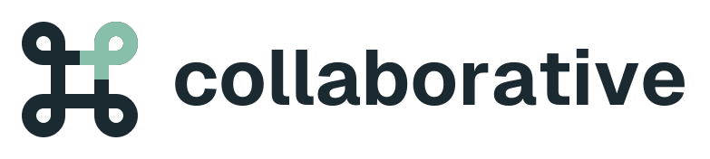
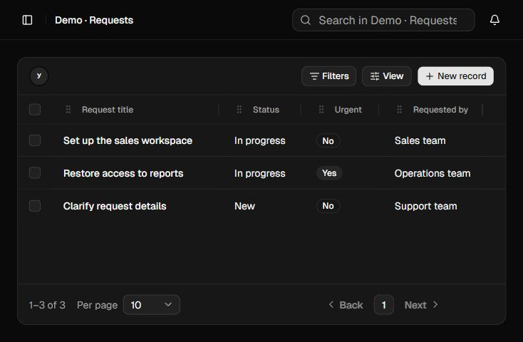
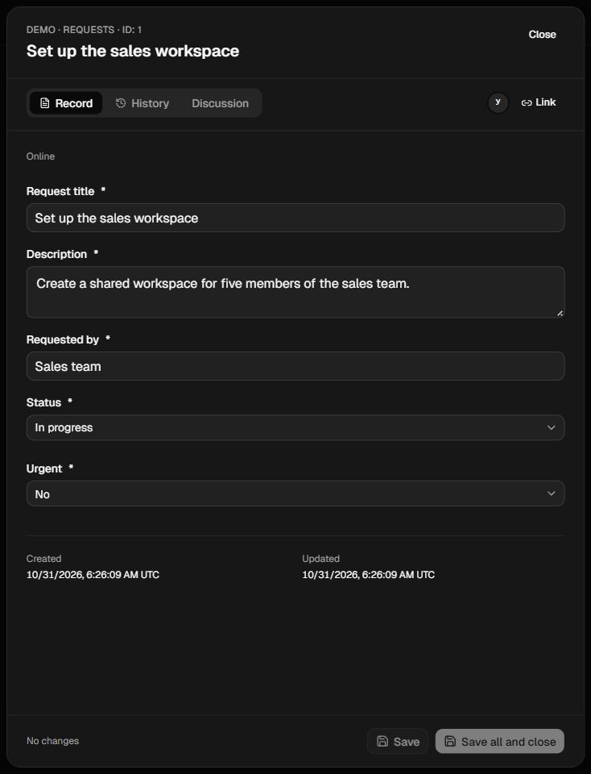

<!-- languages -->

[English](README.md) · [Русский](README.ru.md)

<!-- /languages -->

  <picture>
    <source media="(prefers-color-scheme: dark)" srcset="docs/assets/brand/collaborative-logo-dark.svg">
    
  </picture>

  <strong>Your team's data, in one shared workspace.</strong> 
  Organize records, build forms, and work together — on your own infrastructure.

  
  
  

  <a href="#what-you-can-build">Use cases</a> ·
  <a href="#a-workspace-that-fits-your-team">Explore the product</a> ·
  <a href="#quick-start">Get started</a> ·
  <a href="docs/index.md">Documentation</a>

Collaborative is an open-source workspace for teams that manage structured data
together. Create collections for your work, connect them with relationships, and
give people tables and forms they can use every day. Keep discussions next to the
records and decide who can see or change each part of the data.

Your data lives in PostgreSQL on infrastructure you control. The interface is
available in English and Russian.

_A request collection with fictional demo data._

## What you can build

Use your own collections and fields to model the way your team works:

| Scenario             | A workspace for                                                          |
| -------------------- | ------------------------------------------------------------------------ |
| Requests and intake  | A shared queue with statuses, related customers, attachments, and notes. |
| Catalogs and content | Structured records, descriptions, tags, images, and related entries.     |
| Internal directories | Departments, contacts, resources, and the relationships between them.    |

These are examples of what you can configure, rather than preinstalled templates.

## A workspace that fits your team

### Make the table yours

Choose columns, adjust widths, sort records, and combine filters to find the
right work. Your column settings, sorting, filters, and page size are saved
automatically for each collection. Save named views for yourself or share them
with the team.

Group collections into workspaces and share a link to the right workspace or
record. Colleagues still see only the data their permissions allow.

### Give each record a useful form

Arrange fields into sections and tabs. Use choices, dates, tags, rich text, files,
and related records to capture the information your team needs. Show relevant
fields and choices based on other values in the form. Open a record beside the
table, follow its relationships, and review its change history. Save the record
and staged changes to related records together.

See a record card

  

### Work on the same data together

See who has a record open and which fields they are editing. Saved changes
update open tables and cards. If someone changes a field you are editing,
review the conflict while keeping your local draft.

Discuss a record in its **Discussion** tab. Follow the conversation and receive
in-app notifications when others reply.

### Give people the right access

Control which collections, records, and fields each person can read or change.
Reuse policies across your team, invite colleagues, and support passwords,
passkeys, or external sign-in. Administrators configure the workspace; team
members work within their granted access.

## Bring an assistant into the workspace

The optional assistant can help find records, build filters, answer questions
about accessible data, and create or update records when you ask it to. It uses
your account's permissions and the collections enabled for its tools.
Enable it by connecting an OpenAI-compatible model provider.

Prefer an external AI client? Connect it through **MCP**, sign in with your
Collaborative account, and choose read-only or read-and-write access. Available
collections follow your current account rights and the installation's MCP
settings. The website assistant and external MCP share the same data tools and
permission checks. Find the MCP server address in **Settings → Applications**.

[Assistant guide](docs/features/assistant.md) ·
[External MCP](docs/features/external-mcp.md)

## Quick start

**Collaborative is in early beta.** Each installation is intended for one team.
Check the [feature map and current limits](docs/guide/features.md) before adopting
it for your work. Workspaces organize collections; they do not provide tenant
isolation. Collections are modeled in Collaborative; arbitrary existing
PostgreSQL tables are not automatically imported.

Choose how you want to start:

- **Run the product:** [Docker Compose](deploy/README.md#docker-compose) or
  [Kubernetes with Helm](deploy/README.md#kubernetes-and-helm).
- **Run from source:** [local setup](docs/guide/getting-started.md), including
  configuration and creating your first administrator.
- **Explore the guides:** [collections and records](docs/features/data.md),
  [workspaces and views](docs/features/workspaces.md), and
  [team permissions](docs/features/access.md).

## Connect your tools and extend the product

Use the HTTP API and TypeScript SDK with the same data and access rules as the
interface. The CLI generates types from your installation's schema. Plugins can
add pages, field editors, record panels, and server behavior.

Personal Google Drive and Sheets connections are also available for supported
assistant actions. Server plugins run as trusted code and are installed with
the application.

[HTTP API](docs/reference/http.md) ·
[SDK](docs/reference/sdk-guide.md) ·
[CLI](docs/reference/cli-guide.md) ·
[Build a plugin](docs/development/first-extension.md) ·
[Architecture](docs/development/architecture.md)

## Get involved

Share bugs, questions, and ideas in [GitHub Issues](https://github.com/Asmblyr/Collaborative/issues).
For code contributions, see the [contribution guide](CONTRIBUTING.md).
Report vulnerabilities privately using the [security policy](SECURITY.md).

## License

[MIT](LICENSE). Third-party dependencies retain their own licenses. The optional
local S3 service uses MinIO under AGPL. The wordmark uses Geist under
[SIL OFL 1.1](apps/ui/src/app/fonts/OFL.txt).
