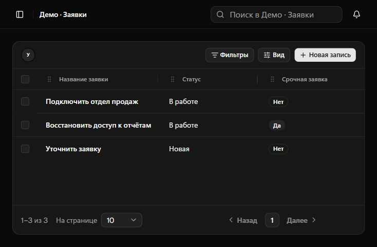
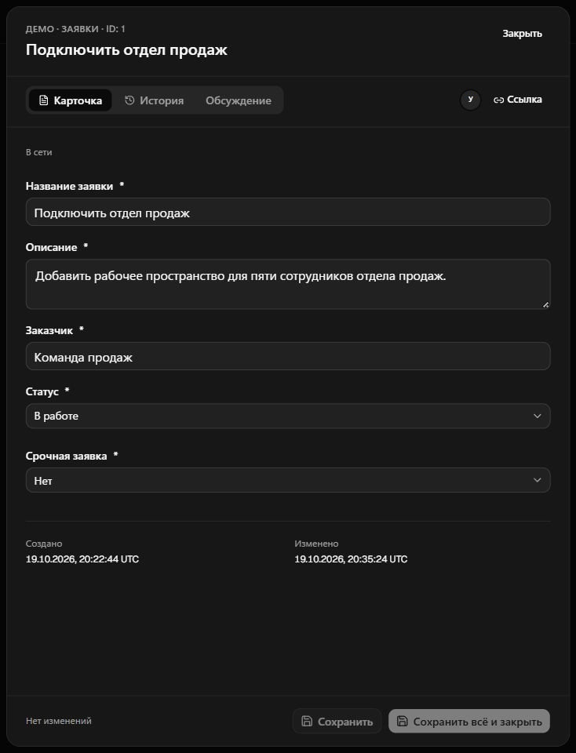

<!-- languages -->

[English](README.md) · [Русский](README.ru.md)

<!-- /languages -->

  <picture>
    <source media="(prefers-color-scheme: dark)" srcset="docs/assets/brand/collaborative-logo-dark.svg">
    
  </picture>

  <strong>Данные вашей команды — в общем рабочем пространстве.</strong> 
  Создавайте коллекции, настраивайте формы и работайте вместе — на своей инфраструктуре.

  
  
  

  <a href="#что-можно-собрать">Сценарии</a> ·
  <a href="#рабочее-пространство-под-вашу-команду">Знакомство с продуктом</a> ·
  <a href="#быстрый-старт">Начать работу</a> ·
  <a href="docs/ru/index.md">Документация</a>

Collaborative — открытое рабочее пространство для команд, которые вместе ведут
структурированные данные. Создавайте коллекции под свои задачи, связывайте записи
между собой и настраивайте таблицы и формы для ежедневной работы. Обсуждайте
вопросы рядом с записью и определяйте, кто может видеть и менять данные.

Данные хранятся в PostgreSQL на инфраструктуре, которую вы контролируете.
Интерфейс доступен на русском и английском.

_Коллекция заявок с вымышленными демо-данными._

## Что можно собрать

Настройте свои коллекции и поля под работу команды:

| Сценарий               | Для чего использовать пространство                                      |
| ---------------------- | ----------------------------------------------------------------------- |
| Заявки и обращения     | Общая очередь со статусами, заказчиками, вложениями и обсуждениями.     |
| Каталоги и контент     | Структурированные записи с описаниями, тегами, изображениями и связями. |
| Внутренние справочники | Отделы, контакты, ресурсы и связи между ними.                           |

Это примеры настройки, а не предустановленные шаблоны.

## Рабочее пространство под вашу команду

### Настройте таблицу под себя

Выбирайте колонки, меняйте их ширину, сортируйте записи и комбинируйте фильтры.
Колонки, сортировка, фильтры и размер страницы автоматически сохраняются за вами
для каждой коллекции. Именованные виды можно оставить личными или сделать общими
для команды.

Объединяйте коллекции в рабочие пространства и отправляйте коллегам ссылки на
нужное пространство или запись. По ссылке каждый увидит только доступные ему
данные.

### Сделайте карточку удобной для работы

Размещайте поля в секциях и вкладках. Используйте варианты выбора, даты, теги,
форматированный текст, файлы и связанные записи. Показывайте нужные поля и
варианты выбора в зависимости от других значений в форме. Открывайте карточку
рядом с таблицей, переходите по связям и просматривайте историю изменений.
Сохраняйте карточку вместе с подготовленными изменениями связанных записей.

Посмотреть карточку записи

  

### Работайте с данными вместе

Видно, кто открыл запись и какие поля сейчас редактирует. Сохранённые изменения
появляются в открытых таблицах и карточках. Если коллега изменил то же поле,
конфликт можно разобрать, сохранив свой локальный черновик.

Обсуждайте запись на вкладке **«Обсуждение»**. Подпишитесь на разговор, чтобы
получать уведомления внутри приложения об ответах коллег.

### Дайте каждому нужный доступ

Определяйте, какие коллекции, записи и поля человек может читать или менять.
Применяйте общие политики, приглашайте коллег и используйте вход по паролю,
passkey или через внешнего провайдера. Администраторы настраивают пространство,
а участники работают в рамках выданных прав.

## Подключите ассистента к работе с данными

Опциональный ассистент помогает искать записи, собирать фильтры, отвечать на
вопросы о доступных данных, создавать и обновлять записи по вашему запросу.
Он работает с правами вашего аккаунта и коллекциями, открытыми для его инструментов.
Для работы нужен подключённый OpenAI-совместимый провайдер моделей.

Предпочитаете внешний AI-клиент? Подключите его через **MCP**, войдите своим
аккаунтом Collaborative и выберите чтение или чтение с записью. Доступные
коллекции определяются текущими правами аккаунта и настройками MCP в установке.
Ассистент на сайте и внешний MCP используют общие инструменты работы с данными
и проверки прав. Адрес MCP-сервера находится в **«Настройки → Приложения»**.

[Ассистент](docs/ru/features/assistant.md) ·
[Внешний MCP](docs/ru/features/external-mcp.md)

## Быстрый старт

**Collaborative находится в ранней бете.** Отдельная установка рассчитана на одну
команду. Перед использованием ознакомьтесь с
[возможностями и текущими ограничениями](docs/ru/guide/features.md).
Рабочие пространства группируют коллекции, но не изолируют арендаторов.
Коллекции создаются в Collaborative; произвольные существующие таблицы
PostgreSQL автоматически не импортируются.

Выберите, с чего начать:

- **Запустить продукт:** [Docker Compose](deploy/README.ru.md#docker-compose) или
  [Kubernetes с Helm](deploy/README.ru.md#kubernetes-и-helm).
- **Запустить из исходников:** [локальная установка](docs/ru/guide/getting-started.md),
  настройка и создание первого администратора.
- **Разобраться в работе:** [коллекции и записи](docs/ru/features/data.md),
  [пространства и виды](docs/ru/features/workspaces.md),
  [права команды](docs/ru/features/access.md).

## Свяжите с другими инструментами и расширяйте

HTTP API и TypeScript SDK работают с теми же данными и правами, что и интерфейс.
CLI генерирует типы по схеме вашей установки. Плагины добавляют страницы,
редакторы полей, панели карточек и серверную логику.

Для поддержанных действий ассистента также доступны личные подключения
Google Drive и Sheets. Серверные плагины устанавливаются вместе с приложением
и выполняются как доверенный код.

[HTTP API](docs/ru/reference/http.md) ·
[SDK](docs/ru/reference/sdk-guide.md) ·
[CLI](docs/ru/reference/cli-guide.md) ·
[Создать плагин](docs/ru/development/first-extension.md) ·
[Архитектура](docs/ru/development/architecture.md)

## Участвуйте в развитии

Вопросы, ошибки и идеи — в [GitHub Issues](https://github.com/Asmblyr/Collaborative/issues).
Для изменений кода есть [руководство участника](CONTRIBUTING.ru.md).
Об уязвимостях сообщайте приватно по [правилам безопасности](SECURITY.ru.md).

## Лицензия

[MIT](LICENSE). Зависимости сохраняют собственные лицензии. Опциональный локальный
MinIO распространяется под AGPL. Логотип использует Geist под
[SIL OFL 1.1](apps/ui/src/app/fonts/OFL.txt).
